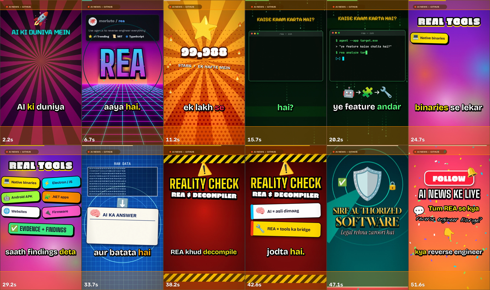

# shorts-video-studio

**Make professional 9:16 Shorts — vertically, in Python, with no video editor.**

A [skill](#install) plus a working reference engine that turns a research topic
and a narration script into a finished **1080×1920 MP4 + SRT + script**: cue-driven
motion graphics, real colour-emoji icons, eight different transitions, kinetic
captions synced to the spoken word, and a synthesized music bed with sound
effects ducked under the voice.

No GPU. No After Effects. No subscription. About 90 seconds of CPU per 50-second
video.

[](LICENSE)
[](https://www.python.org/)
[](https://ffmpeg.org/)
[](#install)
[](CONTRIBUTING.md)

---

## Contents

- [What you actually get](#what-you-actually-get)
- [Why it doesn't look AI-generated](#why-it-doesnt-look-ai-generated)
- [Example output](#example-output)
- [Requirements](#requirements)
- [Quickstart](#quickstart)
- [Install](#install)
- [How the pipeline works](#how-the-pipeline-works)
- [Repository layout](#repository-layout)
- [The four extension points](#the-four-extension-points)
- [Cue-based sync (the core idea)](#cue-based-sync-the-core-idea)
- [Voiceover](#voiceover)
- [QA gate](#qa-gate)
- [Troubleshooting](#troubleshooting)
- [FAQ](#faq)
- [Performance](#performance)
- [Fonts and licensing](#fonts-and-licensing)
- [What this project is not](#what-this-project-is-not)
- [Roadmap](#roadmap)
- [Contributing](#contributing)
- [Credits](#credits)
- [License](#license)

---

## What you actually get

One render produces a complete, uploadable package:

| File | What it is |
|---|---|
| `video.mp4` | 1080×1920, H.264 + AAC, loudness-normalised, `+faststart` |
| `captions.srt` | Word-accurate subtitles cut into 2–3 word chunks |
| `script.txt` | The narration, one paragraph per scene |
| `plan.md` | Scene plan: fonts, palettes, backgrounds, transitions, sources |
| `qa_report.md` | The QA gate result with measured evidence |
| `contact.png` | Contact sheet of sampled frames + every transition frame |

Everything is procedural — Python, OpenCV, Pillow and FFmpeg. The engine is a
single readable file you copy and edit, not a framework you have to learn.

```
 topic + research
        │
        ▼
   script (Hinglish / Hindi / English)
        │
        ▼
  voiceover ──► syllable-peak alignment ──► per-word timings
        │                                        │
        │                                        ▼
        │                              cue lookups  C(scene, "word")
        ▼                                        │
   music + SFX  ◄──── ducking ────┐              ▼
        │                         │      9 scenes × own background,
        └──────────► mix ◄────────┘      palette, fonts, emoji, transition
                       │
                       ▼
        loudnorm (-16 LUFS)  →  H.264 1080×1920  →  QA gate
```

---

## Why it doesn't look AI-generated

The single biggest failure mode of generated video is *sameness*: one font, one
gradient, one transition, ten identical slides. The skill forbids that
explicitly, and the QA gate fails a render that violates it.

> **VARIETY RULES** — violating any of these is a FAIL in the QA gate.
>
> - Every scene has its **own background technique and palette** — rays,
>   synthwave grid, halftone sunburst, code rain, gradient blobs, blueprint grid,
>   hazard stripes, radar rings, confetti. Never two neighbours alike, never one
>   global colour.
> - **≥ 7 different fonts** across the video, mixing categories: condensed
>   impact, chunky display, wide display, grotesque, serif, italic serif,
>   monospace, pixel, handwriting. Max 2–3 fonts inside one scene.
> - **≥ 5 different text treatments**: gradient fill, thick outline + hard
>   offset shadow, glow, letter-by-letter bounce, typewriter, sticker chips,
>   rotated stamp, handwriting tilt.
> - **Real icons, not geometric shapes** — colour emoji, animated with
>   overshoot, spin-in, float, orbit or swing. Never a text-only scene.
> - **8+ different transitions**, one per scene change: glitch, whip-pan blur,
>   zoom-through, iris + ring, slats wipe, flash + shake, pixelate, push-up.
> - **Impact moments** combine effects: spark burst + shockwave ring + camera
>   shake + RGB split + boom SFX.
> - Captions: 2–3 words at a time, thick outline, the active word highlighted in
>   the scene's accent colour, a small pop on every chunk.
> - **Motion on everything.** Nothing appears without animation; nothing sits
>   perfectly still (idle wobble, float, or a slow 0 → 3.5% zoom).

---

## Example output

The bundled engine ships with a complete worked example — an AI-news Short — so
you can render something real before you write a line of your own.



*12 sampled frames from the example render (top and bottom orange bands mark the
platform safe zones). Duration 53.9 s · 1080×1920 · −16.5 LUFS · true peak
−1.4 dBTP.*

Full deliverable set, including the scene plan and QA report, lives in
[`examples/rea-short/`](examples/rea-short/).

---

## Requirements

| | Version | Notes |
|---|---|---|
| Python | 3.11+ | 3.11 and 3.12 are covered by CI |
| FFmpeg | any recent build | `ffmpeg` **and** `ffprobe` must be on `PATH` |
| NumPy | ≥ 1.26 | |
| OpenCV | ≥ 4.8 | the `headless` wheel — no GUI needed |
| Pillow | ≥ 10 | built with `freetype2` (checked by `setup.sh`) |
| SciPy | ≥ 1.11 | WAV I/O, filters, peak detection |
| Fonts | bundled | 15 files, 12 families, all OFL-1.1 |

No GPU, no Node, no LaTeX, no cloud account. The optional voiceover step is the
only thing that can touch the network.

> **`NotoColorEmoji.ttf` is bundled (~10 MB)** so icons work offline. If it is
> missing, `EM()` returns a blank sprite and warns once instead of crashing —
> `setup.sh` tells you how to install a system copy.

---

## Quickstart

```bash
git clone https://github.com/mohdkhatab/shorts-video-studio.git
cd shorts-video-studio

bash skills/shorts-video-studio/scripts/setup.sh   # venv + ffmpeg + font checks
source .venv/bin/activate                          # or: --system install

# 1) smoke test — writes ~26 contact-sheet PNGs, no video, under a minute
cd /tmp && mkdir -p out work && \
TEST=1 OUT_DIR=./out WORK=./work \
FONT_DIR=$OLDPWD/skills/shorts-video-studio/assets/fonts \
python $OLDPWD/skills/shorts-video-studio/scripts/shorts_engine_template.py
# → work/v2_1_50.png … work/v2_tr8.png

# 2) full render of the built-in example (no voiceover: synthesized music only)
FONT_DIR=$OLDPWD/skills/shorts-video-studio/assets/fonts \
OUT_DIR=./out WORK=./work OUT_NAME=example.mp4 \
python $OLDPWD/skills/shorts-video-studio/scripts/shorts_engine_template.py
# → ./out/example.mp4 + captions.srt + script.txt   (~90 s)

# 3) QA it
python $OLDPWD/skills/shorts-video-studio/scripts/review_frames.py \
  out/example.mp4 out/contact.png 12
# → PASS  (duration, codec, resolution, LUFS, true peak)
```

To make **your own** video, install the skill and hand your agent a brief —
[`prompt.md`](prompt.md) is a complete, working example of such a brief.

---

## Install

The skill folder is `skills/shorts-video-studio/` and the folder name must stay
`shorts-video-studio` — it is what the agent matches on.

### Option A — helper script (recommended)

```bash
bash install.sh                    # symlink into ./.opencode/skills/
bash install.sh --target all       # .opencode + .claude + .agents
bash install.sh --global           # ~/.config/opencode/skills/
bash install.sh --copy --dir ~/packaged-project
bash install.sh --uninstall
```

It symlinks by default so the skill stays in sync with your checkout; `--copy`
vendors a snapshot instead.

### Option B — manual

Copy or symlink `skills/shorts-video-studio/` into any of:

| Agent | Project-level | Global |
|---|---|---|
| OpenCode | `.opencode/skills/` | `~/.config/opencode/skills/` |
| Claude Code | `.claude/skills/` | `~/.claude/skills/` |
| Generic agents | `.agents/skills/` | — |

```bash
mkdir -p .opencode/skills
ln -s "$PWD/skills/shorts-video-studio" .opencode/skills/shorts-video-studio
```

### Then

```bash
bash skills/shorts-video-studio/scripts/setup.sh
source .venv/bin/activate
```

Start your agent in the project folder and paste [`prompt.md`](prompt.md) (or
just say *"make me a 50-second short about X"*). The skill loads itself and walks
the pipeline: research → script → scene plan → one voiceover take → build → test
render → final render → QA gate.

---

## How the pipeline works

The skill drives eight steps. Steps 1–3 are thinking, 4–7 are rendering, 8 is
the gate that stops a bad render from being called done.

| # | Step | Output |
|---|---|---|
| 1 | **Research** — web-search 3+ sources for anything time-sensitive; every number gets a date and a URL. Unverifiable claims get softened ("report ke mutabik"). | facts + sources |
| 2 | **Script** — 120–140 words for 45–50 s; hook inside 2.5 s; 7–9 short beats; CTA last. | `script.txt` |
| 3 | **Scene plan** — one scene per paragraph; each gets its own background, palette, 2 fonts, icons, hero animation, cue words and transition. Variety rules applied here. | `plan.md` |
| 4 | **Voice** — one take of the whole script. | `voice.mp3` |
| 5 | **Build** — copy the template, replace `SCENES`, write `bgN`/`dN`, set `HIT`/`TRANS`. Every animation start is a cue lookup. | `video.py` |
| 6 | **Test render** — `TEST=1` writes end-state, mid-state and per-transition PNGs. Look at them. Fix what the gate flags. | `work/*.png` |
| 7 | **Final render** — `VOICE=voice.mp3`, run detached. Visuals follow the voice; audio is never stretched to fit. | `out/video.mp4` |
| 8 | **QA gate** — a judge agent that is *not* the builder verifies the video against measured evidence. | `qa_report.md` |

---

## Repository layout

```
shorts-video-studio/
├── README.md                     ← you are here
├── LICENSE                       ← MIT (code)
├── NOTICE                        ← third-party inventory (fonts, deps, services)
├── CHANGELOG.md
├── CONTRIBUTING.md
├── SECURITY.md
├── requirements.txt
├── install.sh                    ← symlink/copy the skill into an agent config
├── prompt.md                     ← a complete worked brief (ArtCraft / REA Short)
├── docs/
│   └── contact-sheet.png
├── examples/
│   └── rea-short/                ← real script, plan, SRT, QA report, contact sheet
└── skills/shorts-video-studio/
    ├── SKILL.md                  ← the skill: pipeline, variety rules, QA gate
    ├── assets/
    │   └── fonts/                ← 15 OFL-1.1 fonts + licenses + LICENSES.md
    ├── references/
    │   ├── design-bible.md       ← backgrounds, fonts, treatments, icons, effects
    │   └── script-and-voice.md   ← script formula, Hinglish rules, alignment internals
    └── scripts/
        ├── shorts_engine_template.py   ← the engine (copy → video.py)
        ├── tts_elevenlabs.py           ← optional voiceover over REST
        ├── review_frames.py            ← contact sheet + LUFS/peak/layout QA
        └── setup.sh                    ← venv + ffmpeg + font checks
```

---

## The four extension points

The engine is a normal script with four clearly marked `EXTENSION POINT`
blocks. Copy it to `video.py` and edit those; do not rewrite the engine.

```python
# 1. SCENES  — narration text per scene + this scene's accent / highlight colour
SCENES = [
    dict(acc=(255, 0, 120), hi=(255, 230, 0), text="Bhai, tumhe pata hai? ..."),
    ...
]

# 2. BG      — one background function per scene; never reuse a style back-to-back
BG = [bg1, bg2, bg3, bg4, bg5, bg6, bg7, bg8, bg9]

# 3. DRAW    — one draw function per scene, driven by cue lookups
DRAW = [d1, d2, d3, d4, d5, d6, d7, d8, d9]

# 4. HIT / TRANS — camera-shake times and the transition order
HIT   = {0: lambda: [C(0, "Bhai", 0, 0.3), C(0, "naya", 0, 3.4)]}
TRANS = ["glitch", "whip", "zoom", "iris", "slats", "flash", "pixel", "push"]
```

A scene draw function is just "draw things at local time `lt`":

```python
def d3(fr, lt, d):
    t0 = C(2, "hafte", 0, 0.6) - 0.2          # cue: when "hafte" is spoken
    t1 = C(2, "lakh",  0, 1.8) + 0.4
    p  = eo(seg(lt, t0, t1))                   # 0 → 1 over that window
    num = f"{int(100000 * p):,}" + ("+" if p >= 1 else "")
    pop(fr, EM("\u2B50", 230), W / 2, 250, lt, t0 - 0.1, ang0=-220)   # spin-in icon
    blit(fr, TX(num, 104, "chunk", stroke=9, shadow=(0, 10, (70, 20, 0))),
         W / 2, 470, alpha=eo(seg(lt, t0, t0 + 0.3)))                  # count-up number
```

Environment variables:

| Variable | Default | Purpose |
|---|---|---|
| `VOICE` | — | path to a voiceover; enables syllable-peak sync and mixing |
| `ALIGN` | `peaks` | `peaks` (default) or `pauses` (fallback for slow voices) |
| `TEST` | — | write contact-sheet PNGs instead of video |
| `OUT_DIR` / `WORK` | `./out` / `./work` | output and scratch directories |
| `OUT_NAME` | `short.mp4` | output filename |
| `FONT_DIR` | `../assets/fonts` | where the `.ttf` files live |
| `LUFS` | `-16` | integrated loudness target for the final mix |
| `SIL` | `-35dB:0.16` | silence threshold for `ALIGN=pauses` |

Missing fonts fall back to DejaVu / Liberation / Arial with a single `[warn]`
line in the render log, so a broken `FONT_DIR` never hard-crashes a render.

---

## Cue-based sync (the core idea)

Visuals must land on the exact spoken word, not on a guessed timeline. But you
cannot know the timings before the voice exists — and the voice must never be
stretched to fit the visuals.

So the engine works backwards:

```python
t = C(scene, "spokenword", occurrence=0, default_seconds=2.2)
```

**Before** a voiceover exists, `C()` returns the `default_seconds` estimate, so
the video renders immediately. **After** `VOICE=voice.mp3` is supplied,
`apply_voice_peaks()` runs at import time and `C()` returns the real time:

1. FFmpeg → 16 kHz mono → 250–3200 Hz band-pass → smoothed envelope.
2. `find_peaks()` finds syllable nuclei.
3. The script is split into syllables (`syl()` — vowel groups, with overrides for
   digits and acronyms: `AGI=3`, `AI=2`, `5.5=4`).
4. A dynamic-programming match aligns nuclei to syllables (cost `0.15·|peak −
   expected|`, with skip penalties).
5. Word starts come from the first matched syllable; scene starts are the first
   word minus 0.45 s; total duration follows the voice (+1.2 s tail).

That is why the *same* `video.py` renders correctly with estimated timing and
then re-syncs perfectly the moment you hand it an mp3 — you never rebuild the
scene code.

---

## Voiceover

```bash
export ELEVENLABS_API_KEY=sk_...
python skills/shorts-video-studio/scripts/tts_elevenlabs.py --check
python skills/shorts-video-studio/scripts/tts_elevenlabs.py --list-voices
python skills/shorts-video-studio/scripts/tts_elevenlabs.py script.txt voice.mp3
VOICE=voice.mp3 python video.py
```

Defaults target a Hindi documentary narrator that still handles English tech
terms (`VOICE_ID` `KgnO7XaC644NBfmLZmwn`, "Aditya"). Override with `VOICE_ID`,
`MODEL_ID`, `STABILITY`, `SIMILARITY`, `STYLE`, `OUTPUT_FORMAT`.

The script sends the **whole narration as one request** on purpose: a single take
keeps the voice consistent and makes peak alignment stable.

The voiceover is entirely optional and entirely yours:

- ElevenLabs MCP works too — same one-take rule.
- Any TTS you like: drop a `voice.mp3` next to `video.py` and set `VOICE`.
- No TTS at all: the engine renders music + SFX with estimated timing and still
  passes the QA gate (that is exactly what CI does).

`tts_elevenlabs.py` exits `0` ok, `1` usage, `2` network, `3` account/plan.
**Exit 3 means stop** — quota and abuse-detection blocks need a human, not a retry
loop.

---

## QA gate

The skill ends with a gate that a **separate judge agent** (never the builder)
must pass on measured evidence:

| # | Check | Evidence |
|---|---|---|
| 1 | 30–60 s, 1080×1920, H.264 + AAC, roughly **−18 to −13 LUFS**, true peak **< −1 dBTP** | `review_frames.py --json` |
| 2 | No clipped or overflowing text, no overlap, safe zones respected, captions legible on every background | contact sheet + every transition frame |
| 3 | Variety rules satisfied | fonts, palettes, backgrounds and transitions listed in `plan.md` |
| 4 | Every number/date/name traceable to a source; claims softened where unverified; limitations stated | `plan.md` source list |
| 5 | 5 sampled cues (hook, number, name, transition, CTA) land within 0.25 s of the spoken word | SRT/`SW` times vs frame timestamps |

Anything that fails gets fixed and re-rendered. Remaining known issues are
reported honestly rather than hidden.

```bash
python skills/shorts-video-studio/scripts/review_frames.py out/short.mp4 out/contact.png 12
# short.mp4  53.9s  1080x1920  h264 + aac  25.7 MB
# loudness: -16.5 LUFS  (LRA 2.5 LU)   true peak -1.4 dBTP
# duration in 30-60s: True
# wrote out/contact.png  (12 frames, 6 cols)
# PASS
```

It exits non-zero on failure, so it drops straight into CI.

---

## Troubleshooting

| Symptom | Cause | Fix |
|---|---|---|
| `error: externally-managed-environment` | PEP 668 — you are piping into the system Python | `setup.sh` handles this by using `.venv`. Or `--system` if you really mean it |
| `ModuleNotFoundError: No module named 'cv2'` | venv not activated | `source .venv/bin/activate` |
| `ffmpeg missing` | FFmpeg not installed | `sudo apt-get install -y ffmpeg` / `brew install ffmpeg` |
| Icons render as blank squares | `NotoColorEmoji.ttf` not found | keep it in `assets/fonts/`, or `apt-get install -y fonts-noto-color-emoji` |
| `PIL freetype2: False` | Pillow built without FreeType | reinstall: `pip install --force-reinstall --no-binary :all: pillow` |
| `No fonts: set FONT_DIR` | moved the scripts without the fonts | `FONT_DIR=/path/to/assets/fonts` |
| `TypeError: expected string or buffer` | non-contiguous array slice handed to Pillow | keep sprites as contiguous arrays; `rcard()` returns a PIL image, not an array |
| Assertion error in `cv2.add` | empty band slice | guard `b > a` before slicing |
| Render dies when the tool call returns | the process was not detached | `setsid nohup python video.py > render.log 2>&1 &` then poll `render.log` |
| Audio too quiet / gate fails on loudness | mix never normalised | fixed in 1.1 — set `LUFS=-15` if your platform prefers hotter |
| Sync drifts on a very fast AI voice | pause-based alignment finds too few pauses | keep the default `ALIGN=peaks` |
| Two elements fight over one word | overlapping cue windows | offset the second cue by 0.2–0.4 s |
| Emoji look soft/blurry | wrong resize interpolation | `INTER_AREA` down, `INTER_CUBIC` up (already handled in `EM()`) |
| Can't download MCP-generated audio | sandbox boundary | ask the user to upload the mp3/wav; build with estimated timing meanwhile |

---

## FAQ

**Do I need an AI image or video model?**
No. Every pixel is drawn procedurally — gradients, rays, grids, code rain,
halftone, particles, blurred glow — composited with OpenCV and Pillow. That is
why it is fast, deterministic and free.

**Do I need ElevenLabs?**
No. It produces the nicest narration, but the engine's music bed, SFX and
estimated timing produce a complete, gate-passing video on their own.

**Why 720×1280 inside the engine if the output is 1080×1920?**
Rendering at 720p and upscaling once with Lanczos + a light unsharp mask is ~2×
faster and, on moving graphics, visually indistinguishable. The shipped file is
genuinely 1080×1920.

**Can I use a different canvas, like 1080×1080?**
Yes — `W`/`H`/`FPS` are constants at the top of the engine, and the safe-zone
numbers are documented in `references/design-bible.md`. Every layout number in
the template assumes 9:16, so expect to re-tune positions.

**Why are captions 2–3 words at a time?**
Retention: big, fast, high-contrast chunks read instantly and keep the eye on the
frame. Full-sentence subtitles get skipped.

**Can it run on a VPS or in Termux?**
Yes — the only hard requirement is FFmpeg and no GPU. CI runs it headless on
Ubuntu, and the engine writes PNGs without ever opening a window.

**Is the Hindi/Hinglish text hardcoded?**
No. Script language is whatever you write into `SCENES`/`script.txt`; the
Hinglish conventions in `references/script-and-voice.md` (Roman script, numbers
spoken as words, no ALL CAPS) are guidance, not a constraint.

**Why does it check the loudness in LUFS instead of dB?**
Because "dB" from `volumedetect` is unweighted RMS and is not comparable across
material with different crest factors. Pre-1.1 versions of this engine compared
that number to a LUFS target, which meant the engine could fail its own gate
while sounding fine. See [CHANGELOG](CHANGELOG.md).

**How do I delete one scene?**
Remove its entry from `SCENES`, remove the matching entries from `BG` and `DRAW`,
and `HIT` (keyed by scene index) and `TRANS` re-index themselves. Keep
`len(BG) == len(DRAW) == len(SCENES)`.

---

## Performance

Measured on one modern x86 CPU core, Python 3.12, OpenCV headless, 720×1280 → 1080×1920:

| Workload | Time |
|---|---|
| `TEST=1` smoke render (26 PNGs, no video) | ~40 s |
| Full 54 s video, no voiceover | ~90 s |
| Full 50 s video with voiceover | ~2–3 min |

Cost is dominated by per-frame numpy compositing of backgrounds and glows, then
`libx264 -preset veryfast -crf 20`. Memory stays well under 1 GB. Long renders
should be detached and polled, because agent tool calls have timeouts:

```bash
setsid nohup python video.py > render.log 2>&1 &
tail -f render.log
```

---

## Fonts and licensing

- **Code, docs and examples:** [MIT](LICENSE).
- **Fonts** (`skills/shorts-video-studio/assets/fonts/`, 15 files / 12 families):
  [SIL Open Font License 1.1](https://openfontlicense.org). Per-font license text
  ships beside each binary; see
  [`assets/fonts/LICENSES.md`](skills/shorts-video-studio/assets/fonts/LICENSES.md).
- **Noto Color Emoji** is OFL-1.1 (`Copyright 2013 Google LLC`) — its license
  text is bundled as `NotoColorEmoji-OFL.txt`.
- **FFmpeg** is invoked as an external process, never linked, so its license does
  not propagate here. Runtime dependency licenses are listed in
  [`NOTICE`](NOTICE).

If you add a font, it must be redistributable (OFL/MIT/Apache/CC0), and you must
add its license file plus a row in `LICENSES.md` and `NOTICE`.

---

## What this project is not

- **Not a fact-checker.** The pipeline insists on dated sources and hedged
  wording, but *you* (or your agent) are responsible for the claims in your video.
- **Not a text-to-video model.** Nothing here is generative pixels; it is
  procedural motion graphics driven by your script.
- **Not a stock-footage or brand-logo library.** The variety rules explicitly
  forbid brand logos, and there is no video/photo ingestion — only emoji icons
  and drawn backgrounds.
- **Not a legal shield.** If your topic involves cloning, reverse engineering or
  competitors, the skill's wording rules (say "clean-room alternative", never
  "stole") help, but compliance is on you.

---

## Roadmap

- [ ] Extract the engine into importable modules (`backgrounds.py`, `effects.py`)
      with the template keeping only the extension points.
- [ ] Golden-frame regression test: hash a few frames so visual changes are
      caught in CI, not in review.
- [ ] Optional photo/video plate ingestion with the same cue system.
- [ ] Local TTS backend (Piper) so the whole pipeline runs offline end-to-end.
- [ ] Per-platform safe-zone presets (Shorts / Reels / TikTok / Square).
- [ ] `--dry-run` scene-plan linter that fails a plan violating the variety rules
      before anything renders.

Ideas and PRs welcome — see [CONTRIBUTING.md](CONTRIBUTING.md).

---

## Contributing

Bug reports need two things to be actionable: the **exact command** and the **raw
output**. Visual bugs need a frame — `ffmpeg -ss 27.1 -i out/short.mp4 -frames:v 1 /tmp/frame.png`.
Design-rule violations (two neighbouring scenes sharing a background, fewer than
7 fonts, a repeated transition) are treated as bugs, because they are what makes
the output look machine-made.

See [CONTRIBUTING.md](CONTRIBUTING.md) for the rules, [SECURITY.md](SECURITY.md)
for how to report a vulnerability privately, and
[CHANGELOG.md](CHANGELOG.md) for what changed and why.

---

## Credits

Built as an agent skill for [OpenCode](https://opencode.ai) and compatible with
Claude Code and other Agent Skills hosts.

Bundled typefaces are the work of their respective authors — Big Shoulders,
Boldonse, Bricolage Grotesque, Erica One, Gloock, Instrument Serif, JetBrains
Mono, Nothing You Could Do, Noto Color Emoji, Pixelify Sans, Tektur and Work
Sans. See [`NOTICE`](NOTICE) for links to every upstream project.

The example Short in `examples/` is an AI-news explainer about the ArtCraft /
FilmCraft "Craft" apps; its sources and dates are listed in its `plan.md`.

---

## License

[MIT](LICENSE) for the code and documentation. Bundled fonts are OFL-1.1 and are
not covered by the MIT grant — see [NOTICE](NOTICE).
